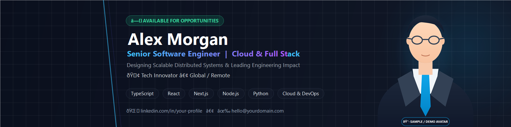

# 🚀 LinkedIn Banner Studio — Open Source Banner Generator Template

[](LICENSE)
[](#-how-to-deploy-live-on-github-pages)
[](https://www.linkedin.com)
[](#)

A modern, free, and open-source web application template to design **Professional LinkedIn Profile Banners** in seconds, built according to LinkedIn's official **1584 &times; 396 px (4:1 aspect ratio)** standard.

Zero build steps required! Crafted with HTML5 Canvas, Tailwind CSS, and vanilla JavaScript. Anyone can run it locally in any web browser or deploy it to **GitHub Pages** with 2 clicks.

---

## 📸 Preview



---

FOR ALL CAN USE THIS BANNER

## ✨ Features

- 🎯 **LinkedIn Safe Zone Simulator:** Live visual overlay of the circular profile avatar (desktop & mobile positions) to ensure headlines, titles, and faces are never obscured.
- 🎨 **4 Modern Professional Themes:**
  1. **Modern Tech Dark:** Cyber navy, circuit grid lines, cyan glow, and clean tech pill badges.
  2. **Executive Navy & Gold:** Deep royal blue with refined geometric gold lines for corporate and consulting excellence.
  3. **Emerald Minimalist:** Architectural obsidian with vibrant mint green accents for precision and clarity.
  4. **Creative Violet Mesh:** Deep indigo and vibrant neon purple gradient glow.
- 📸 **Custom Photo Upload & Auto Background Removal:**
  - Drag & Drop your own photo (transparent PNG or regular studio JPG).
  - Built-in **Auto Chroma Key tool** to remove studio red, blue, or green backdrops directly in the browser!
  - Sliders for horizontal offset and photo scaling.
- ⚡ **Full Customization:** Name, professional role/headline, value proposition, status kicker, company/university, contact info, and skill tags.
- 💾 **1-Click Lossless Export:** Generates high-definition PNG (1584 &times; 396 px) instantly without server uploads, plus Copy to Clipboard.

---

## 📂 Project Structure

```text
linkedin-banner-studio/
├── index.html              # Main responsive web studio UI (Tailwind CSS CDN)
├── src/
│   └── app.js              # Canvas Engine 1584x396, Chroma Key, & Auto Export
├── assets/
│   ├── preview.png         # Template banner preview image
│   └── sample-photo.png    # Generic modern placeholder avatar
├── README.md               # Project documentation
├── LICENSE                 # MIT License
└── .gitignore
```

---

## 🚀 How to Put This Project on GitHub

### Option A: Via GitHub Website (Easiest — No Git Install Needed)

1. Go to [github.com](https://github.com/) and log in to your account.
2. Click the **"+"** icon in the top right &rarr; select **"New repository"**.
3. Name your repository, e.g. `linkedin-banner-studio`.
4. Choose **Public** &bull; Keep *Add a README file* unchecked.
5. Click **Create repository**.
6. On the new repository page, click the **"uploading an existing file"** link.
7. Drag & drop the files from this folder (`index.html`, `src/`, `assets/`, `README.md`, `LICENSE`, `.gitignore`).
8. Click **Commit changes**. Done! 🎉

---

### Option B: Via Git CLI

```bash
git init
git add .
git commit -m "feat: initial commit of LinkedIn Banner Studio template"
git branch -M main
git remote add origin https://github.com/YOUR_USERNAME/linkedin-banner-studio.git
git push -u origin main
```

---

## 🌐 How to Deploy Live on GitHub Pages (100% Free)

To give your project a live public website URL (e.g. `https://YOUR_USERNAME.github.io/linkedin-banner-studio/`):

1. Go to your repository on GitHub.
2. Navigate to **Settings** &rarr; **Pages** (in the left sidebar).
3. Under **Build and deployment &rarr; Branch**:
   - Select branch: **`main`**
   - Folder: **`/ (root)`**
4. Click **Save**.
5. Within 1–2 minutes, GitHub will publish your live website link!

---

## 📜 License

Distributed under the **MIT License**. Free for everyone to use, adapt, and customize.
